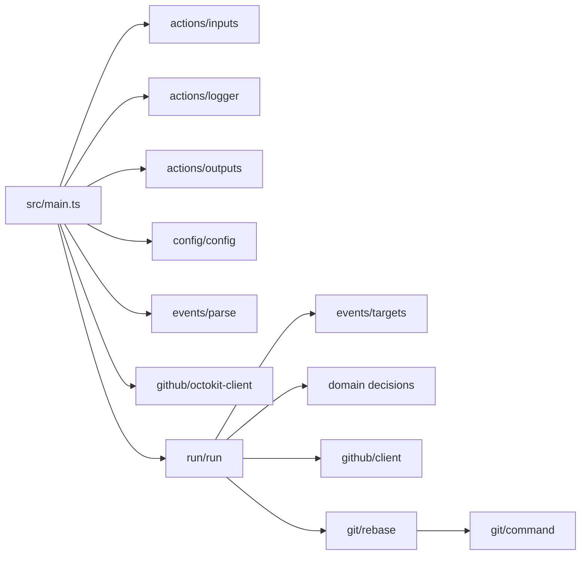

# Architecture

The action is split into a pure core and a thin side-effect shell.

## Pure modules

- `config/config.ts` parses action inputs into a readonly `Config`. Invalid
  enum values and a missing token are returned as `Result` errors.
- `domain/labels.ts` parses required/blocking label filters and matches them.
- `domain/merge-state.ts` classifies `mergeable_state`, decides whether a
  behind probe is needed, and normalizes `behind_by`.
- `domain/update-decision.ts` decides whether to update.
- `domain/merge-decision.ts` decides whether to skip, wait, or merge, and
  computes the commit title.
- `events/parse.ts` validates the raw webhook payload and returns a
  discriminated `ParsedEvent`.
- `events/targets.ts` resolves an event into a pull request target, a base
  fan-out target, a commit lookup target, or a not-ready/ignored/unsupported
  result.

These modules do not read `process.env`, log, sleep, or call the network. They
are covered by unit tests.

## Shell modules

- `src/main.ts` reads env/inputs, reads the event file, creates the GitHub and
  git adapters, runs the orchestration, writes outputs, and sets the action
  failure state for unexpected errors. It is the only module that calls
  `core.setFailed`.
- `actions/*` adapt `@actions/core` input, output, logging, and secret masking.
- `github/client.ts` is the injected GitHub interface.
- `github/octokit-client.ts` is the `@octokit/core` adapter. It is the only
  place that maps raw API responses to domain snapshots and maps request
  failures to `GitHubError`.
- `git/command.ts` runs git through `@actions/exec.getExecOutput` with
  `silent: true`, `ignoreReturnCode: true`, and a redacted command string for
  clone operations (the clone URL contains the token).
- `git/rebase.ts` implements clone/fetch/merge-base/rebase/push. It receives a
  `cloneUrl` function so tests can use a local repository.
- `git/tmpdir.ts` creates a temporary directory under `RUNNER_TEMP` when
  available and removes it with `@actions/io.rmRF`.
- `run/resolve-state.ts` retries only when `mergeable_state` is unknown or
  missing, up to 3 attempts, 2 seconds apart.
- `run/process-pull-request.ts` applies update and merge decisions, refreshes
  after an update, handles merge races, and performs the post-merge update
  fan-out.
- `run/run.ts` executes the resolved target plan sequentially; reads are
  discovered through the client and writes are serialized.

## Decision order

For a pull request:

1. Fetch the pull request. If mergeability is unknown/missing, retry the fetch
   up to 3 attempts.
2. Evaluate update eligibility (state, merged, head repository, labels).
3. If eligible, resolve `behind`:
   - `behind` → true;
   - `blocked`/`unstable` → compare the base and head and use `behind_by > 0`;
   - other states → false.
4. Apply the update decision. After an update attempt, refresh the pull request.
5. Evaluate the merge decision against the refreshed snapshot.
6. If the merge result is `merged`, list up to 10 open pull requests based on
   the same base, exclude the merged PR, and run update-only for each.

## Errors

- Config, event, GitHub, and git failures are `Result` values with
  discriminated error objects.
- Expected failures produce a log and a `skipped`, `not_ready`, or
  `merge_failed` output.
- Unexpected exceptions are caught once in `src/main.ts` and reported with
  `core.setFailed`.
- No `throw` is used for control flow; `assertNever` is reserved for impossible
  unions and malformed external state that cannot be mapped.

## Constants

- `MAX_PULL_REQUESTS_PER_RUN = 10` in `run/limits.ts`.
- `UNKNOWN_STATE_RETRIES = 3` and `UNKNOWN_STATE_RETRY_DELAY_MS = 2000` in
  `run/resolve-state.ts`.
- `FETCH_DEPTH = '10'` and `FETCH_TIMEOUT_MS = 60_000` in `git/rebase.ts`.
- Mergeable states: `clean`, `has_hooks`, `unstable`.
- Not-ready states: `blocked`, `behind`, `dirty`, `draft`, and unrecognized
  external values.

## Tests

- Pure parsing/decision tests use factories only.
- The orchestration tests use a fake `GitHubClient`, logger, sleep, and output
  sink. They cover update/merge ordering, unknown retries, merge races, label
  independence, base fan-out, commit lookups, and output selection.
- Git tests use temporary local repositories and the real `@actions/exec` git
  runner; they do not need a token or a real pull request.
